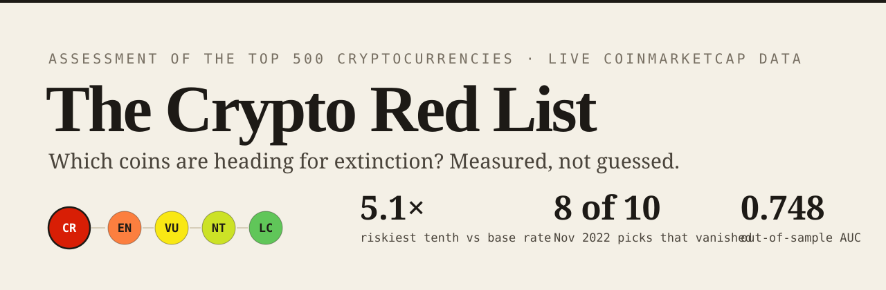

<div align="center">

<a href="https://crypto-red-list.vercel.app"></a>

<br>

<a href="https://crypto-red-list.vercel.app"></a>


<h3>
  <a href="https://crypto-red-list.vercel.app">The list</a> ·
  <a href="https://crypto-red-list.vercel.app/time-machine">Time machine</a> ·
  <a href="https://crypto-red-list.vercel.app/method">How it works</a> ·
  <a href="https://crypto-red-list.vercel.app/api/redlist">Open JSON</a> ·
  <a href="https://crypto-red-list.vercel.app/feed.xml">Alerts (RSS)</a>
</h3>

</div>

---

## The problem

Over half of all crypto projects ever launched are dead ([CoinGecko: 11.6M of ~20.2M by end of 2025](https://www.crowdfundinsider.com/2026/01/257221-dead-coins-over-50-of-cryptocurrencies-have-failed-report-reveals/)). Price sites show you a coin *after* it collapses; graveyards list it *after* it is gone. Nobody tells you, with evidence, **which of today's top 500 coins are heading for extinction**.

Biology solved this decades ago. The **IUCN Red List** sorts species into *Least Concern → Critically Endangered* by their risk of extinction, and the **Red List Index** tracks a whole group's health over time.

## The idea

**The Crypto Red List applies the IUCN method to the top 500 coins, using CoinMarketCap's own historical census.** Every coin gets:

- an IUCN category (**CR · EN · VU · NT · LC**, plus **DD** for too-new and **NE** for stablecoins and tokenized assets),
- a **measured chance of vanishing within 12 months** (e.g. *"28 in 100 coins with this profile vanish within a year"*),
- the **criteria met** and plain-language reasons (*"Lost 80% of its exchange pairs in 6 months"*),
- an official-style **assessment sheet** with the receipts: every CMC call behind the number.

And the whole market gets one number: the **Crypto Red List Index** (1.000 = every coin Least Concern), tracked from 2019 to today.

## Does it work? Tested on years it never saw

The model was trained on quarterly cohorts **Nov 2019 – Nov 2021** and tested on **Nov 2022 – Nov 2025** (5,526 coin-quarters it never saw). CMC's historical census includes coins that later died, so there is **no survivorship bias**. The tested weights are the shipped weights.

| Category (test years) | Coins | Predicted | **Actually vanished** |
|---|---:|---:|---:|
| 🟢 Least Concern | 4,896 | 2.7% | **2.2%** |
| 🟡 Near Threatened | 292 | 7.6% | **5.1%** |
| 🟡 Vulnerable | 250 | 16.0% | **23.6%** |
| 🟠 Endangered | 78 | 27.8% | **47.4%** |
| 🔴 Critically Endangered | 10 | 41.8% | **70.0%** |

- **AUC 0.748** out of sample, against **0.581** for market rank alone.
- The riskiest tenth vanished **21.0%** of the time against a 4.1% base rate: **5.1×**.
- **15 Nov 2022:** the list named 10 coins most at risk. **8 of them vanished within a year.** ([see it in the time machine](https://crypto-red-list.vercel.app/time-machine))
- Selling red-listed coins beat holding everything in **21 of 25 quarters** (13 of 13 test quarters). The edge is small (~1 point a year): it is a filter for what to avoid, **not** a strategy that beats CMC's CMC100 index, and the site says so.

## What makes it different

| | Typical crypto dashboard | **Crypto Red List** |
|---|---|---|
| Question answered | "What is the price doing?" | **"Will this coin still exist next year?"** |
| Output | A chart or a score | **A calibrated probability + IUCN category + reasons** |
| Proof | None | **Out-of-sample backtest on 8 years of point-in-time CMC data** |
| Freshness | Varies | **Live: refreshed every 6 hours from CMC** |
| Beyond the site | — | **Embeddable status badges, RSS alerts, open JSON** |

### Features

- **The list:** live census bar, Red List Index, threatened coins as field-guide specimens, *"Threatened inside the CMC100"*, coins **uplisted** since last quarter, and a searchable register of all 500.
- **Field check:** paste your holdings, see each one's status. Runs in your browser; nothing is sent anywhere.
- **Assessment sheets:** IUCN scale, probability meter, criteria with danger lines, track record per category, coin profile and receipts.
- **Time machine:** pick any quarter since 2019 and see what the list said then and what really happened, benchmarked against the CMC100.
- **Embeddable badge:** `` puts a live status badge in any README.
- **Extinction alerts:** [`/feed.xml`](https://crypto-red-list.vercel.app/feed.xml) RSS of coins moving to a higher-risk category.

## How a status is decided

1. **Three warning signs**, from CMC data today and 6 / 12 months ago:
   - **A · Falling behind the market:** 12-month market-cap change relative to the median top-500 coin (so a market-wide crash does not paint everything red).
   - **B · Exchanges leaving:** share of exchange pairs lost in 6 months.
   - **D · Nobody trading:** 24h volume as a share of market cap.
   - *(Rank drop, criterion C, was tested and removed: it made out-of-sample predictions worse.)*
2. **One probability:** a six-weight logistic regression anyone can read (`src/redlist/model.json`).
3. **Probability → category,** IUCN criterion E style: CR ≥ 40%, EN ≥ 20%, VU ≥ 10%, NT ≥ 5%.

Data traps found and fixed along the way (each with a test): CMC reports **zero volume** for many healthy coins since late 2025 (now "not reported", not "dead"); **wrapped and staked tokens** are excluded from the live listing but present in history (now excluded everywhere); **tokenized stocks and gold** are Not Evaluated.

## CoinMarketCap API: 10 endpoints, each with a purpose

| Endpoint | Powers | Refresh |
|---|---|---|
| `/v1/cryptocurrency/listings/latest` | Today's top 500: pairs, volume, market cap | 6 h |
| `/v1/cryptocurrency/listings/historical` | Snapshots 6 and 12 months back; the 33-quarter census behind training and the time machine | 6 h |
| `/v2/cryptocurrency/info` | Logos, summaries, websites, launch dates | 24 h |
| `/v3/fear-and-greed/historical` | Market mood next to the Red List Index over time | 24 h |
| `/v3/fear-and-greed/latest` | Today's mood | 6 h |
| `/v1/global-metrics/quotes/latest` | Total market cap, BTC dominance, altcoin share | 6 h |
| `/v1/altcoin-season-index/historical` | 90-day altcoin season context | 6 h |
| `/v3/index/cmc100-latest` | Threatened members of CMC's flagship index | 6 h |
| `/v3/index/cmc100-historical` | CMC100 benchmark in the time machine | per backtest |
| `/v1/key/info` | Live credit-budget meter (0 credits) | 6 h |

- **Works on the free Basic plan:** worst case about **8.2k credits a month** (one shared cache for every page and the API; Next.js keeps serving the last good data if CMC fails).
- **Every call is evidence:** each page lists the calls behind it (endpoint, params, HTTP status, credits, timestamp); `/api/redlist` includes them as JSON.
- **Graceful degradation:** an endpoint refused by the plan hides its panel; the rest of the page renders.
- Honest API feedback: [FEEDBACK.md](FEEDBACK.md).

## Run it

```bash
npm ci
cp .env.example .env          # add CMC_PRO_API_KEY
npm run dev                   # http://localhost:3000
npm run redlist               # today's list in the terminal (~62 credits)
npm run verify                # secret scan + typecheck + lint + 130 tests
```

Reproduce the research (needs a CMC plan with history back to 2018):

```bash
npm run census                # download the 33-quarter census to data/census (not committed)
npm run calibrate             # train on 2019-21, test on 2022-25 -> src/redlist/model.json
npm run backtest              # time machine -> src/redlist/backtest-results.json
```

## Code

```
src/cmc/        CMC client with evidence ledger, cache with stale fallback
src/redlist/    signals, model, assessment, census mapping, time machine, Red List Index
src/live/       live list, coin info, fear & greed, market context, shared caches
src/web/        status metadata, badges and feed, UI components
app/            pages, /api/redlist, /badge/[symbol], /feed.xml, share card
scripts/        census download, calibration, backtest, terminal list, secret scan
tests/          130 tests (Vitest), including guards on the shipped model and published results
```

Built test-first in TypeScript (strict) on Next.js 16. The API key lives only in a gitignored `.env` and as a Vercel secret; a secret scanner runs as part of `npm run verify`.

## Honest limits

- It predicts **disappearance from CMC's top 3,000**, not price. A coin can lose 90% and stay listed.
- The model is cautious: Vulnerable and Endangered coins vanished more often than predicted in the test years.
- Critically Endangered is rare because it needs several signs at once.
- "Vanished" coins occasionally return; migrations and rebrands can look like extinctions.
- Not financial advice.

---

<div align="center">

**Crypto Red List** · Built for the CoinMarketCap API Hackathon (#BuildwithCMC) · by **Parth Pawar** · MIT

</div>
